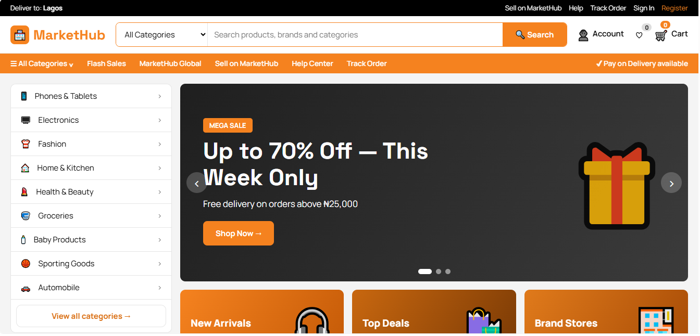

# MarketHub

[](https://github.com/akpan-thankgod/markethub/actions/workflows/test.yml)
[](https://akpan-thankgod.github.io/markethub/)
[](LICENSE)

A responsive e-commerce storefront for the Nigerian market, built with plain **HTML, CSS and JavaScript** (no frameworks, no build step).
Browse products, search and filter, manage a cart, check out, track orders and manage an account.

> **Two modes:** on GitHub Pages (below) the site is a front-end demo: accounts, carts, orders and wishlists live in the browser (`localStorage`)
> and **no real payments are processed**. With the optional PHP + MySQL backend (`api/`, `db/`) everything is saved on the server and card / bank-transfer
> orders can be paid for real through Paystack. See [Backend](#backend) and [docs/backend.md](docs/backend.md).

**Live demo:** [akpan-thankgod.github.io/markethub](https://akpan-thankgod.github.io/markethub/)



## Features

- **Home:** rotating hero slider, flash sales with countdown, category tiles, top-selling and recommended products
- **Catalogue:** one listing page for every category, search and brand, with filters (category, price, brand, rating, discount, seller, delivery), sorting, grid/list view and pagination
- **Product page:** gallery, colour/style options, quantity, offers, specifications, sample reviews, similar and recently viewed products
- **Cart:** items grouped by seller, quantity controls, save for later, promo codes, live totals
- **Checkout:** saved addresses, delivery methods, card / bank transfer / pay on delivery, validation, order confirmation
- **Accounts:** register and sign in, order history with tracking timeline and reorder, addresses, wishlist, profile and password change
- **Payments (with the backend):** card and bank transfer on Paystack's hosted page, confirmed on the server and by signed webhook; Pay on Delivery in selected cities
- **Admin page (with the backend):** search and filter orders, update their status, mark transfers as paid
- **Info pages:** help centre, FAQ, track order, contact, about, terms, privacy and a seller application form
- Responsive layout, keyboard-friendly (skip link, focus styles), respects reduced-motion settings

## Tech stack

HTML5 · CSS3 (custom properties, grid, flexbox) · vanilla JavaScript (ES2020) · `localStorage` for demo persistence · optional PHP 8 + MySQL backend · Paystack for payments

## Getting started

No install needed. Serve the folder over HTTP (sign-in hashing needs `localhost` or `https`, so opening the file directly won't work):

```bash
# Option 1: VS Code → install "Live Server" → right-click index.html → Open with Live Server
# Option 2: Python
python -m http.server 5500
# then open http://localhost:5500
```

## Testing

An automated end-to-end suite ([Playwright](https://playwright.dev)) walks through the whole shopping journey in a real browser:
register, sign in, search and filter, product options, cart and promo codes, checkout, orders and tracking, addresses, wishlist, profile,
info pages, phone-width layout and keyboard access. It also fails on any JavaScript error or broken request.

```bash
npm install
npx playwright install chromium   # one-time browser download
npm test                          # runs headless and starts a local server for you
npm run test:headed               # watch the browser do it
npm run test:report               # open the HTML report after a run
```

Requires Node 18+. The tests run in order and share one browser session, so don't run a single test on its own.

On GitHub, [Actions](.github/workflows/test.yml) runs the browser tests **and** the backend API tests (against a real MySQL database) on every push.

## Backend

A PHP + MySQL backend lives in `api/` and `db/`, and **all six build phases are done**: database and product catalogue, accounts (hashed passwords, CSRF protection, login rate-limiting), cart, wishlist and addresses saved on the server, orders (prices, promo codes, delivery fees and stock worked out on the server, real status and tracking), **online payments through Paystack**, and an **admin page** for orders. The pages detect the backend automatically; without it (e.g. on GitHub Pages) they fall back to browser-storage demo mode.

Online payment switches on when you add a Paystack key to `api/config.local.php`; until then card and transfer orders stay *pending*. Setup, deployment guide and security notes: [docs/backend.md](docs/backend.md).

## Project structure

```
markethub/
├─ index.html        Home
├─ category.html     Category / search / brand listing   (?c=phones  ?q=earbuds  ?brand=Apple)
├─ product.html      Product details                     (?id=205)
├─ cart.html         Shopping cart
├─ checkout.html     Checkout
├─ account.html      Sign in / register, and My Account
├─ admin.html        Admin: orders (needs the backend and an admin account)
├─ page.html         Info pages                          (?p=help | faq | about | terms | privacy | track | contact | seller)
├─ css/style.css     Shared styles
├─ js/
│  ├─ app.js         Shared: header/footer, cart, wishlist, auth, home page
│  ├─ phones.js, accessories.js   Product data
│  └─ category.js, product.js, cart.js, checkout.js, account.js, login.js, pages.js, admin.js   Page logic
├─ images/products/  Optional product photos (see README inside)
├─ api/              PHP backend: auth/, products/, cart/, wishlist/, addresses/, orders/, payments/, admin/ endpoints, lib/ helpers
├─ db/               schema.sql, seed.sql (generated by build-seed.js), orders-cli.php (order helper for the command line)
├─ docs/backend.md   Backend setup guide and build plan
├─ tests/            e2e.spec.js (browser), api.spec.js, pay.spec.js (with a fake Paystack), admin.spec.js; config in playwright.config.js
└─ docs/screenshots/ README images
```

## Adding products

Add rows to `js/phones.js` / `js/accessories.js`, or to the `PRODUCTS` array in `js/app.js`. Product photos: drop `images/products/<id>.jpg` files in and set `USE_PHOTOS = true` in `js/app.js`.

## Demo limitations

These apply to the **GitHub Pages demo mode** only. With the PHP backend, data, passwords (bcrypt), order status and payments are handled on the server.

- Data lives in each visitor's browser only, so nothing is shared between devices.
- Passwords are salted and hashed (PBKDF2) in the browser, which is **not** a substitute for server-side authentication.
- Card details are validated but never stored or sent. Order tracking is simulated.
- Terms and Privacy pages are templates and need legal review before any real launch.

## Roadmap

- [x] Backend (PHP + MySQL): accounts and products, cart, wishlist, orders
- [x] Payments via a hosted provider (Paystack)
- [x] Real order status, admin page for orders
- [x] Automated tests
- [x] Deployment guide
- [ ] Order and password-reset e-mails
- [ ] Seller dashboard
- [ ] Product photos and image optimisation

## License

[MIT](LICENSE)